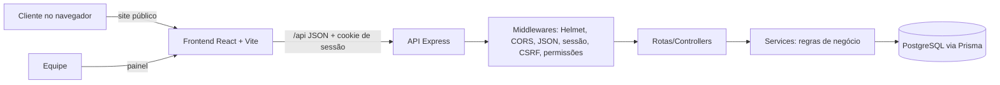
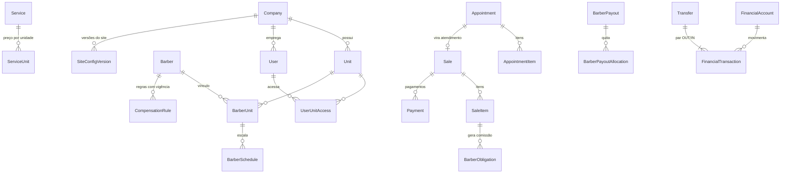

# 2. Arquitetura

## Visão geral

Camadas do backend:

| Pasta | Responsabilidade |
|---|---|
| `src/routes` | Mapeia URL → validação → controller |
| `src/controllers` | Traduz HTTP ↔ serviço (sem regra de negócio) |
| `src/services` | Regras de negócio, transações, autorização por unidade |
| `src/validators` | Esquemas Zod das entradas |
| `src/middlewares` | Sessão, CSRF, permissões, erros |
| `src/utils` | Dinheiro (`decimal.js`), criptografia, auditoria, erros |
| `prisma/` | `schema.prisma`, migrações e seed |

## Modelo de dados (resumo)

Esquema completo: `backend/prisma/schema.prisma` (36 tabelas, comentado).

## Decisões (ADRs)

### ADR-01 — Sessão no servidor com cookie, não JWT
- **Contexto:** painel web de mesmo site; precisamos revogar acesso na hora (demissão, troca de senha).
- **Decisão:** token aleatório de 256 bits em cookie `HttpOnly`, `SameSite=Lax`, `Secure` em produção; no banco só o SHA-256 do token. Expiração absoluta (12 h) e por inatividade (2 h).
- **Alternativas:** JWT em localStorage (vulnerável a XSS, sem revogação simples).
- **Consequência:** uma consulta ao banco por requisição autenticada; aceitável no porte do sistema.

### ADR-02 — CSRF com token sincronizado + verificação de origem
- Token CSRF por sessão enviado no cabeçalho `X-CSRF-Token`; `Origin/Referer` validados contra `CORS_ORIGINS`; corpo obrigatoriamente JSON.

### ADR-03 — Conflito de agenda garantido pelo banco
- **Decisão:** restrição `EXCLUDE USING gist (barberId =, tstzrange(startsAt, endsAt) &&)` ignorando cancelados/não comparecidos.
- **Por quê:** checagem só na aplicação falha com requisições simultâneas. Teste dispara 8 inserções paralelas e só 1 é gravada.

### ADR-04 — Dinheiro em DECIMAL + decimal.js; JSON como string
- Valores trafegam como `"20.00"` (string) para não passar por `Number`.

### ADR-05 — Snapshot e imutabilidade financeira
- Itens de venda guardam preço, custo e regra aplicada; movimentações confirmadas nunca são apagadas — correção via `REVERSAL` com `reversalOfId` único.

### ADR-06 — Atendimento = `Sale` ligada a `Appointment`
- Evita duas tabelas com o mesmo papel. Venda avulsa de produto = `Sale` sem agendamento.

### ADR-07 — Obrigações com profissionais em uma tabela
- Comissão, remuneração fixa, aluguel de cadeira, bônus e ajustes são `BarberObligation` com `direction` (empresa→barbeiro ou barbeiro→empresa). Pagamentos (`BarberPayout`) quitam obrigações via alocações, o que permite pagamento parcial e separa **calculado / devido / pago / pendente**.

### ADR-08 — Prisma 7 com driver adapter `pg`
- Prisma 7 não usa mais o binário de consultas em tempo de execução (cliente em TypeScript/WASM + `@prisma/adapter-pg`). Usamos o gerador `prisma-client-js` para manter o projeto 100% JavaScript.
- Restrições que o Prisma não expressa (EXCLUDE, CHECK, índices parciais) ficam em migração SQL escrita à mão: `prisma/migrations/20261028170100_constraints`.
- **Observação de ambiente:** a migração `20261028170000_init` foi gerada a partir do DMMF do schema seguindo as convenções do Prisma Migrate, porque o ambiente de construção não tinha acesso ao servidor de binários do Prisma. Na primeira execução com `npx prisma migrate dev`, se o Prisma apontar alguma diferença de formato, ele mesmo gera uma migração corretiva — não há perda de dados.

### ADR-09 — Escopo de unidade recalculado a cada requisição
- `req.ctx.unitIds` é montado no middleware de sessão. Mudanças de acesso valem imediatamente; serviços sempre filtram por `companyId` e por `unitIds`.
